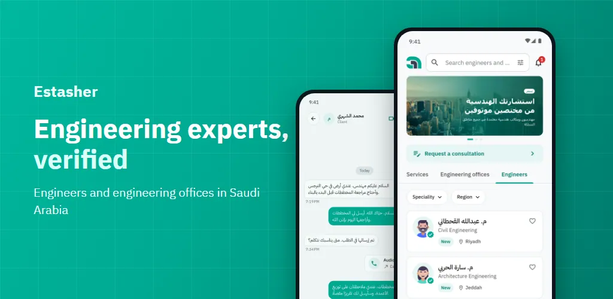
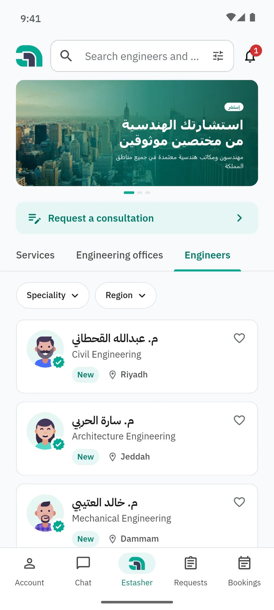
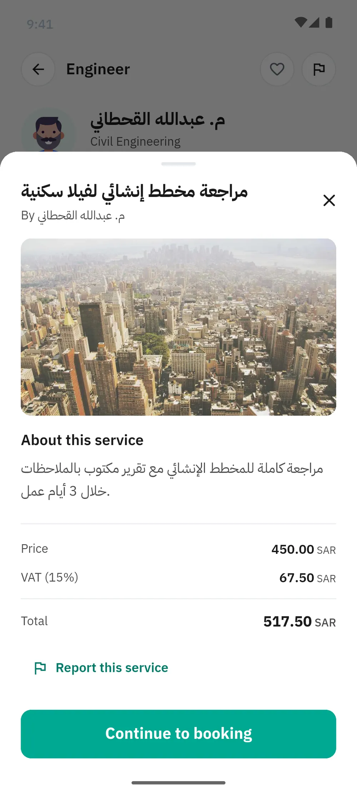
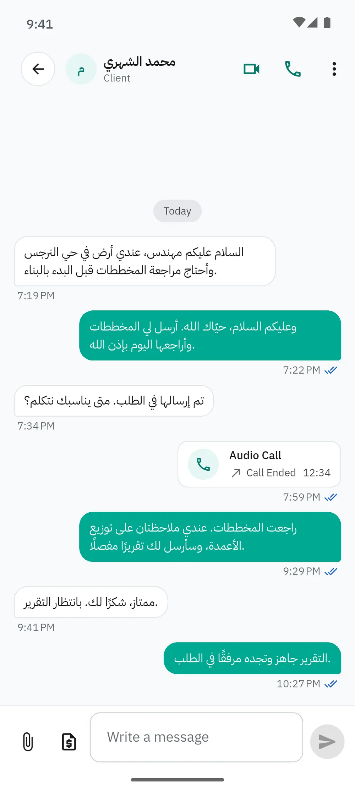
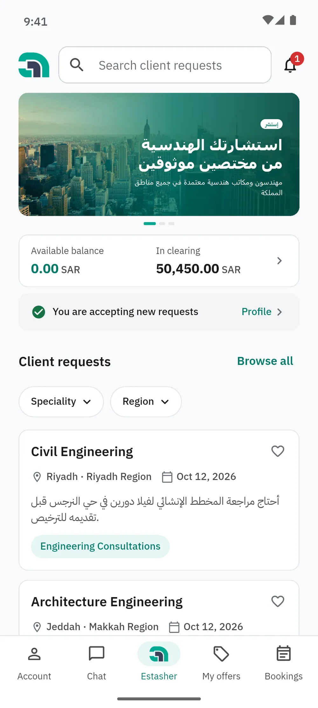

  

# Estasher

**A bilingual iOS and Android marketplace where clients in Saudi Arabia book consultations and request offers from verified engineers and engineering offices.**

> **Portfolio showcase.** The source code is private (client project). This repository presents the project with screenshots and a technical overview. Full case study: **[farhadnazir.com/projects/estasher](https://farhadnazir.com/projects/estasher/)**

 

| | |
|---|---|
| **Type** | Engineering consultation marketplace app |
| **Categories** | Mobile app, SaaS product, Business system, Web application |
| **Platforms** | Mobile, Cross-platform, Backend & API, Web |
| **My role** | Full-stack developer (took over October 2026) |
| **Client** | Estasher |
| **Status** | Live on iOS and Android |
| **Timeline** | 2026 |

## Overview

Estasher (إستشر) is an Arabic-first marketplace app for engineering help in Saudi Arabia. Home owners, companies and contractors use it to find verified engineers and engineering offices, book a consultation or service directly, or post a request and compare written offers. Clients and providers use the same app on iOS and Android, and staff run the platform from a web dashboard.

Every order carries its own chat, voice notes, file sharing and in-app voice and video calls, followed by revisions and a rating. Providers register with their documents, and staff check them before a provider can appear in the app.

Previous developers built the earlier versions. I took the project over on 1 October 2026, and in the 12 days before the launch date the client had set, I built a new server, rebuilt sign-in, payments, uploads, notifications and calls, redesigned the app and rebuilt the admin dashboard. I have kept shipping releases since, up to v1.2.12 on 10 November 2026.

**Who it is for:** Clients in Saudi Arabia who need engineering help, the independent engineers and engineering offices who serve them, and the Estasher staff who run the platform.

## The problem

Finding a trustworthy engineer or engineering office for a consultation, a design, a licence, surveying, a soil test or a drawing review is hard, and prices and timelines are often unclear. Estasher was created to put verified providers, clear prices and the whole conversation in one place.

When I reviewed the delivered app on 1 October 2026, it was not ready for real customers. Sign-in, uploads, notifications and calls depended on services that were offline or no longer existed, there was no backend server, and the admin dashboard was not hosted anywhere. The client had a launch date close behind.

## The solution

I moved trust from the phone to a server I built. A new PHP API now owns identity, money, files, call tokens and push notifications. The app still reads and writes its everyday data in Cloud Firestore, but security rules allow only the server to mark an order paid or a commission settled.

On the product side, I redesigned every client and provider screen on a single Arabic and English design system, added guest browsing, revisions, ratings, reporting and support chat, and rebuilt the staff dashboard. When the business moved to free booking with direct payment to providers, I added a payment mode switch and in-app commission payments for providers.

I also moved the code and services to the client's own accounts, moved the marketing website to the client's domain and hosting, set up automated TestFlight builds, and handled the store listings and submissions.

## Key features

- **Browse first, sign in later.** Visitors can browse engineers, engineering offices and services before creating an account. Sign-in is needed only to book or chat.
- **Book directly or request offers.** Clients book a service from a provider's page, or post a request with the speciality, city and drawings or photos and accept one of several priced offers.
- **Clear prices with VAT.** Every service shows the price, 15% VAT and total before booking. The server validates the VAT fields and gives each order a sequential number such as EST-000123.
- **Server-verified payments.** When card payment is switched on, card and Apple Pay payments through Moyasar are confirmed only after the server reads the payment back from Moyasar and checks the amount, currency and order. A webhook and a scheduled check recover payments if the phone drops out mid-payment.
- **Free booking and provider commissions.** Staff can switch the platform to free booking, where the client pays the provider directly. Providers then settle the platform commission in the app by card or Apple Pay, or by bank transfer that staff confirm.
- **Chat, voice notes and files.** Each order has its own conversation with photos, PDFs and recorded voice notes, stored on the server with access rules for each type of file.
- **Voice and video calls.** Clients and providers can call each other inside the app during an active order. On Android the phone rings on a native incoming-call screen even when the app is closed.
- **Verified providers.** Engineers and engineering offices register in five steps with their documents and expiry dates. Staff approve or reject with a reason, providers get a reminder before a document expires, and the account is put on hold when it does.
- **Revisions, ratings and appointments.** Clients can ask for up to three revisions on a delivered order and then rate the provider. Appointments can only be booked inside a provider's working hours, with a reminder before each one.
- **Staff dashboard.** A bilingual web dashboard covers orders, customers, provider approvals, services and reviews, finance and VAT, commissions and payouts, home banners, notifications, reports, the support inbox and staff accounts.

## Screenshots

<table>
<tr>
<td width="33%" valign="top" align="center"> The client home screen, shown with demo data.</td>
<td width="33%" valign="top" align="center"> Price, VAT and total are shown before the client books.</td>
<td width="33%" valign="top" align="center"> Each order has its own chat with files, voice notes and calls.</td>
</tr>
<tr>
<td width="33%" valign="top" align="center"> Providers use the same app to manage requests and their balance.</td>
</tr>
</table>

## Architecture

The mobile app is built in Flutter for iOS and Android, with an MVVM structure, its own design system in IBM Plex Sans Arabic, full Arabic and English localization, and light and dark themes. The staff dashboard is a separate Flutter web app. Both use Firebase Authentication, Cloud Firestore and Firebase Cloud Messaging.

Next to Firebase, I built a self-hosted API in plain PHP with no external packages, so it runs on the client's shared hosting and can move to a VPS unchanged. It has modules for sign-in, bookings, payments, files, calls, push notifications, SMS and support, its own MySQL (MariaDB) tables, and scheduled jobs for payment reconciliation, booking expiry, reminders and provider document holds.

- **Phone sign-in owned by the server.** SMS codes are sent through Taqnyat, stored hashed and checked on the server, which then issues a Firebase custom token. Each limit, per number, per IP and service-wide, is a single conditional database update, so simultaneous requests cannot get past a cap.
- **Payments the phone cannot fake.** I made the order exist before any charge, then mark it paid only after the server re-reads the Moyasar payment with the secret key and commits the change conditionally in Firestore. A payments audit table records every payment, and duplicates, mismatches and refunds raise alerts.
- **No dependencies, written by hand.** I wrote Firebase token signing and verification and an Agora AccessToken2 builder in plain PHP, so the API needs nothing beyond what shared hosting provides.
- **Calls debugged on live builds.** I traced Android phones not ringing with the app closed to a context bug in the incoming-call plugin and fixed it, then found and fixed three separate iPhone call faults until iPhone-to-Android audio and video worked.
- **Strict Firestore security rules.** The app writes bookings, chats and offers directly to Firestore under a detailed rules file, while payment and commission fields can be changed only by the API's service account.
- **Tests and automated iOS releases.** At handover the three codebases had 9,084 automated checks, against one inherited test file, including a concurrency suite that runs the real PHP classes in parallel against MariaDB. A GitHub Actions macOS workflow with fastlane builds and uploads every iOS release to TestFlight.

## Tech stack

`Flutter` · `Dart` · `Firebase` · `PHP` · `MySQL` · `iOS` · `Android` · `Moyasar` · `Agora` · `Taqnyat SMS` · `GitHub Actions` · `fastlane`

## Results

- **12 days** From takeover to a working product (1 to 12 October 2026, against a launch date the client had set)
- **9,084** Automated checks at handover (Across the app, server and dashboard, against one inherited test file)
- **18** TestFlight builds in the first 12 days (Built and uploaded by an automated GitHub Actions pipeline)
- **v1.2.12** Latest store release (Releases from v1.2.0 on 13 October to v1.2.12 on 10 November 2026)

## Links

- Case study: https://farhadnazir.com/projects/estasher/
- Download on the App Store: https://apps.apple.com/sa/app/estasher-%D8%A7%D8%B3%D8%AA%D8%B4%D8%B1/id6502868240
- Get it on Google Play: https://play.google.com/store/apps/details?id=com.smartech.estasher
- Visit the Estasher website: https://estasher.com.sa
- Watch the promo video: https://www.youtube.com/shorts/XQWDlyonYFE

## About the developer

Built by **Farhad Nazir**, full-stack software developer in Riyadh, Saudi Arabia, and founder of [Techwine Solutions](https://www.techwinesolutions.com). I build SaaS platforms, business systems, and mobile and desktop apps.

[Portfolio](https://farhadnazir.com) · [LinkedIn](https://www.linkedin.com/in/farhadnazir) · [Email](mailto:farhadnazirksa@gmail.com) · [WhatsApp](https://wa.me/966536566380)

---

Screenshots are shown for portfolio purposes. Rights to each product and its branding belong to their owners. Screens marked "recreated" use demo data, so no real customer data appears.
